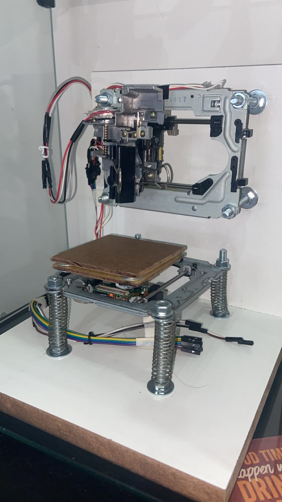
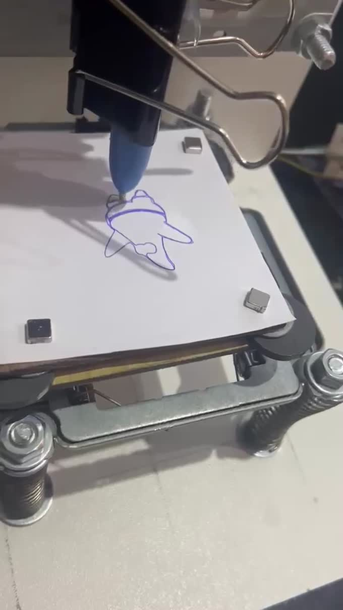
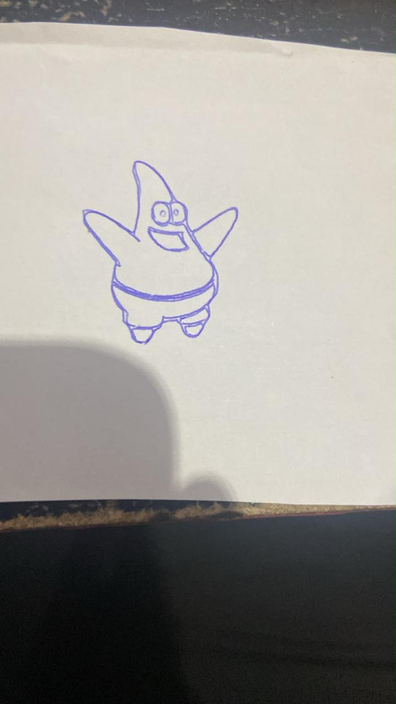
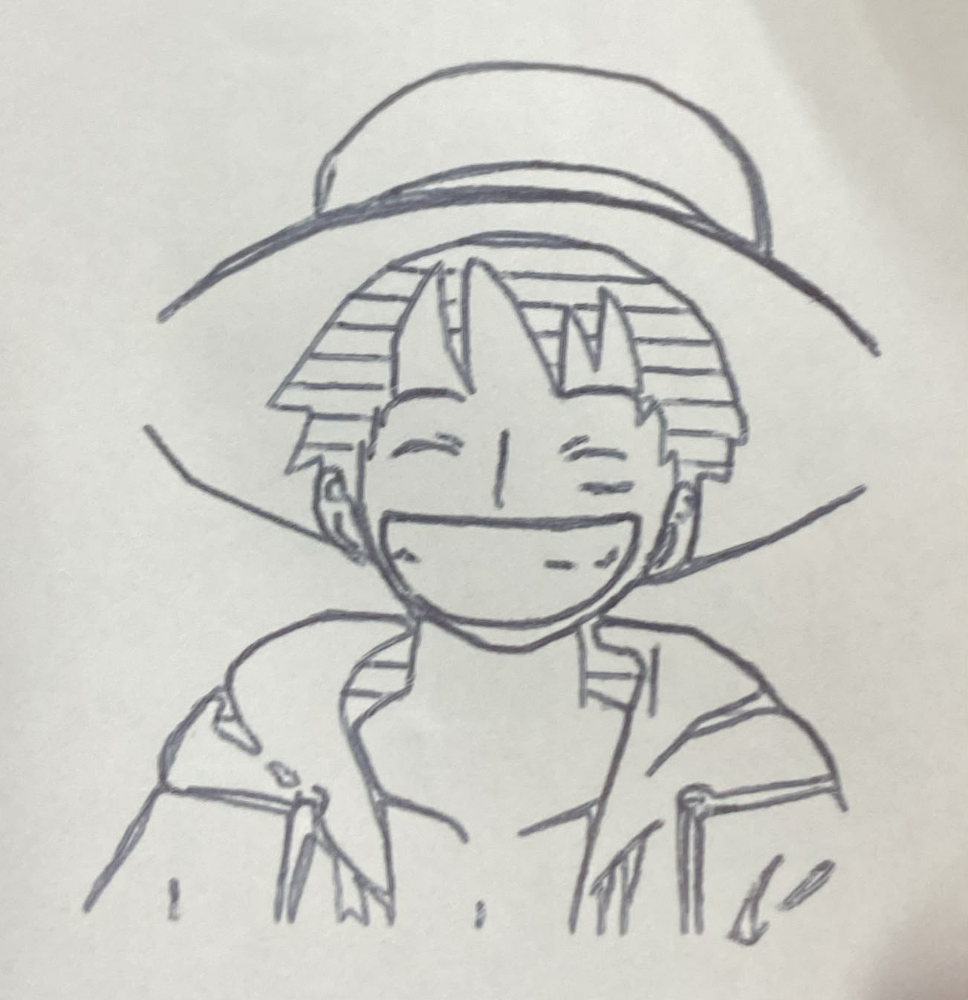
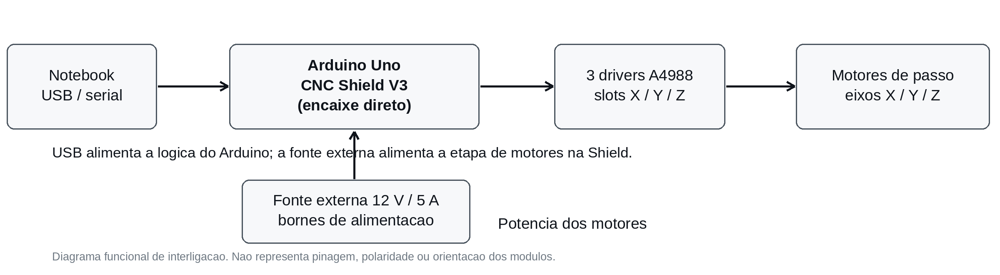
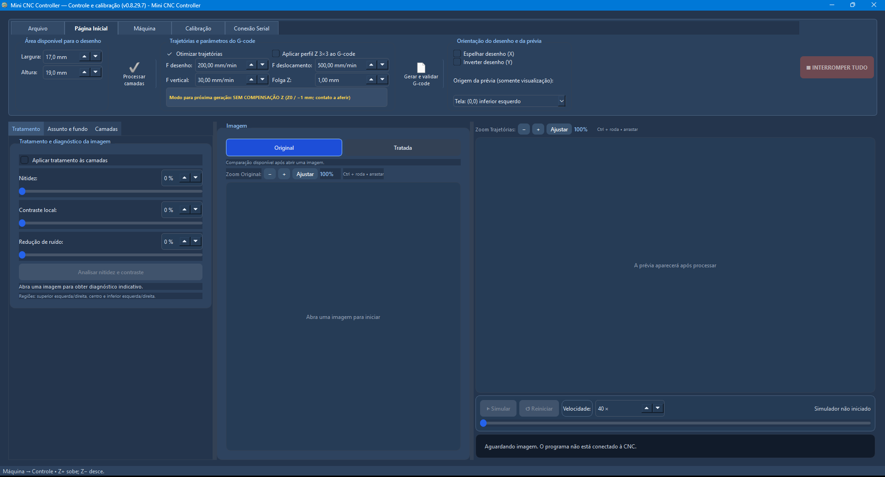
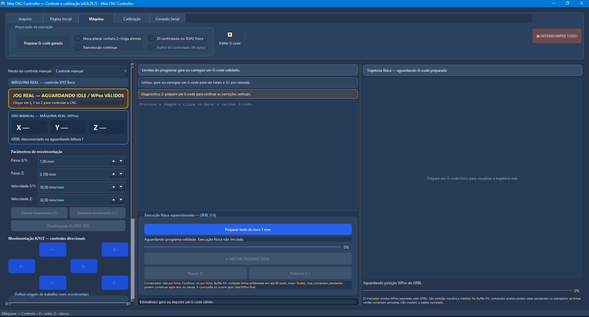
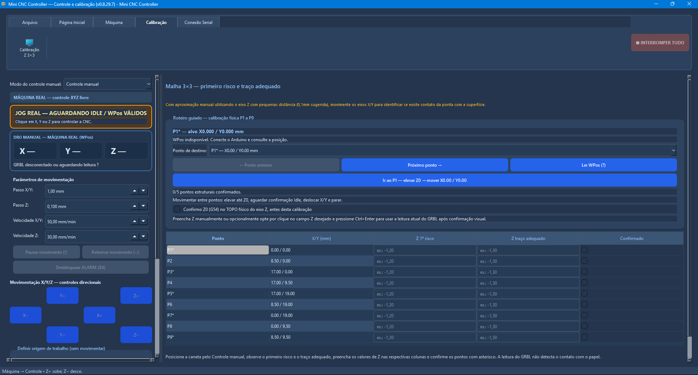
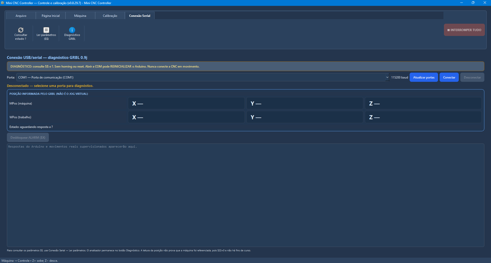

# Mini CNC Controller

**Da imagem ao desenho no papel: aplicativo desktop, visão computacional e controle de um plotter XYZ construído com mecanismos reaproveitados.**

Desenvolvi o **Mini CNC Controller**, um aplicativo Windows em **Python/PySide6**, e integrei sua operação a um mini plotter com **Arduino Uno, CNC Shield V3 e GRBL 0.9j**. O projeto reúne construção mecânica, ajustes elétricos, processamento de imagens, segmentação assistida por IA, planejamento de trajetórias, geração de G-code e execução supervisionada.

Este repositório apresenta a construção e os resultados como **portfólio de desenvolvimento e integração de sistemas**. Reúne documentação, fotos, vídeos e um relatório técnico. O aplicativo, seu código-fonte e seus executáveis não são distribuídos aqui.

**[Assistir ao desenho em execução](docs/videos/04_execucao_patrick.mp4)** · **[Ler o relatório ilustrado](relatorio/Relatorio_Tecnico_Mini_CNC_Controller.pdf)** · **[Entender a visão computacional e IA](docs/visao_computacional.md)**

<p align="center">
  
</p>

## O que desenvolvi neste projeto

- **Aplicação desktop:** interface com tratamento e comparação de imagens, camadas, máscaras, editores, prévias e simulação.
- **Processamento de imagens:** enquadramento, nitidez, contraste, redução de ruído, extração de contornos, detalhes e sombreamento.
- **Integração de IA local:** avaliação e integração assistiva de modelos pré-treinados para propor máscaras de assunto e fundo, com revisão humana.
- **Planejamento e G-code:** conversão em trajetórias 2D, otimização dos deslocamentos, importação, edição, validação e exportação do programa.
- **Controle da máquina:** comunicação USB/serial, interpretação do estado GRBL, controle manual XYZ, calibração e acompanhamento da execução.
- **Construção e testes:** reaproveitamento de mecanismos de DVD/disquete, montagem, alinhamento, ajustes elétricos e desenhos em papel.

A trilha de montagem utilizada como referência e os componentes de terceiros estão identificados nos [créditos](docs/creditos_licenca.md). A autoria do aplicativo e da integração não implica autoria sobre o firmware GRBL, as bibliotecas, os modelos de IA ou os personagens usados nos ensaios.

## Demonstrações e resultados

| Registro | O que observar | Vídeo |
| --- | --- | --- |
| Teste inicial do motor | Acionamento antes da montagem | [20 s](docs/videos/01_teste_motor_antes_montagem.mp4) |
| Execução inicial sem função Z | Etapa intermediária da integração | [35 s](docs/videos/02_execucao_inicial_sem_z.mp4) |
| Teste sem caneta | Movimentação para ajustar limites | [16 s](docs/videos/03_calibracao_limites_sem_caneta.mp4) |
| Desenho Patrick | Traçado físico em papel | [81 s](docs/videos/04_execucao_patrick.mp4) |
| Demonstração Luffy | Registro curto do protótipo em operação | [13 s](docs/videos/05_execucao_luffy.mp4) |

[](docs/videos/04_execucao_patrick.mp4)

| Resultado em papel | Outro resultado em papel |
| :---: | :---: |
|  |  |

Os personagens são obras de terceiros, empregados como imagens de teste. Os vídeos e fotografias demonstram funcionamento e resultados qualitativos; não constituem ensaio de precisão ou repetibilidade. [Ver registros e limitações](docs/resultados.md).

## Como o sistema funciona

```text
Imagem → enquadramento e tratamento → máscara revisada e camadas
       → trajetórias 2D → G-code → validação e simulação
       → calibração e confirmação → USB/serial → GRBL → motores XYZ
```

O desenho é planejado em X/Y; o eixo Z eleva ou aproxima a caneta, com suporte a compensação de superfície. A prévia e a simulação são etapas de conferência. A execução física permanece supervisionada.

| Conjunto | Escolha utilizada |
| --- | --- |
| Mecânica | Dois mecanismos de DVD e um de disquete, bases de madeira e suporte de caneta |
| Controle | Arduino Uno com CNC Shield V3 encaixada diretamente |
| Motores | Três drivers A4988, um por eixo |
| Alimentação | Lógica por USB; motores por fonte externa de 12 V / 5 A |
| Firmware | GRBL 0.9j, projeto de terceiros |
| Aplicativo | Windows, Python, PySide6, OpenCV, NumPy, Pillow, scikit-image e pyserial |
| IA opcional | LR-ASPP, DeepLabV3 e IS-Net; inferência local com modelos pré-treinados |



O diagrama mostra a interligação funcional; não é um esquema de pinagem, polaridade ou montagem elétrica. [Materiais, ferramentas e medições do protótipo](docs/hardware.md).

## Visão computacional e IA aplicada

O tratamento de imagem e a extração de traços usam processamento clássico. A IA auxilia a **segmentação do assunto e do fundo**, propondo uma máscara que pode ser corrigida e composta antes da aplicação às camadas.

Foram avaliados **LR-ASPP, DeepLabV3 e IS-Net**, sem declarar um vencedor universal. Minha contribuição está na integração dos modelos ao fluxo do aplicativo, na interação com o operador e na conexão com máscaras, camadas e trajetórias. Não se reivindicam o treinamento dessas redes, uma arquitetura neural própria ou geração de imagens por IA.

**[Fluxo de visão computacional, decisões e limites](docs/visao_computacional.md)**

## Interface do aplicativo

| Página Inicial | Máquina e execução |
| :---: | :---: |
|  |  |
| **Calibração Z 3×3** | **Conexão serial** |
|  |  |

As capturas e o PDF documentam a **v0.8.29.7**. A evolução posterior dos fontes está registrada na [linha do tempo](docs/evolucao.md); a validação física não se estende automaticamente a todas as versões ou funcionalidades. [Escopo da validação](docs/validacao.md).

## Documentação

- [Relatório técnico ilustrado em PDF](relatorio/Relatorio_Tecnico_Mini_CNC_Controller.pdf)
- [Construção, materiais, ferramentas e elétrica](docs/hardware.md)
- [Arquitetura funcional](docs/arquitetura.md)
- [Recursos do aplicativo](docs/software.md)
- [Visão computacional e modelos de IA](docs/visao_computacional.md)
- [Calibração e operação supervisionada](docs/calibracao_seguranca.md)
- [Evolução do projeto](docs/evolucao.md)
- [Resultados e vídeos](docs/resultados.md)
- [Validação e limitações](docs/validacao.md)
- [Autoria, referências e direitos](docs/creditos_licenca.md)

**Projeto e aplicativo: Eduardo Braz.** Este portfólio documenta um protótipo pessoal e a experiência de desenvolvimento, sem oferecer software para instalação ou uma máquina comercial certificada.
