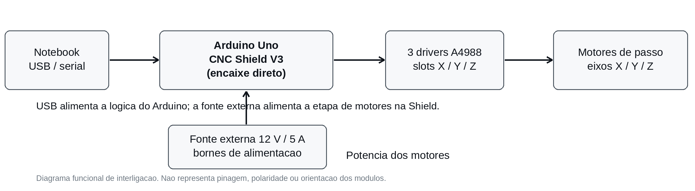
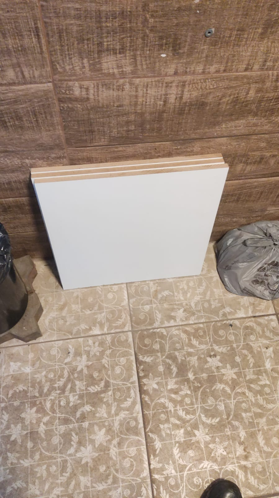
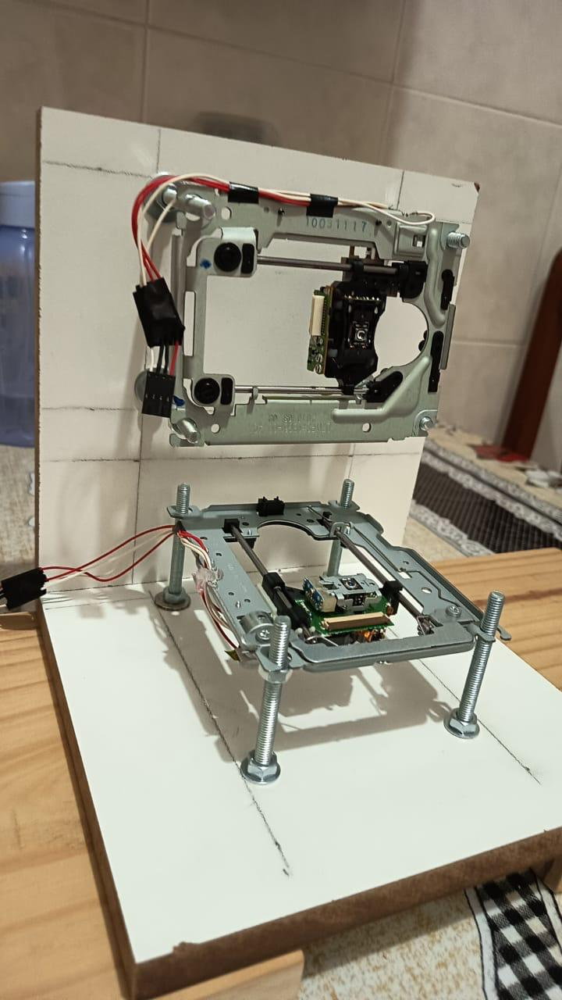
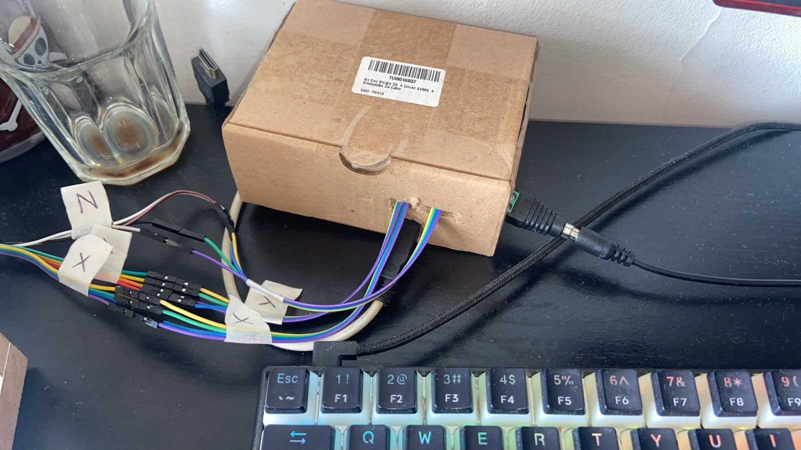
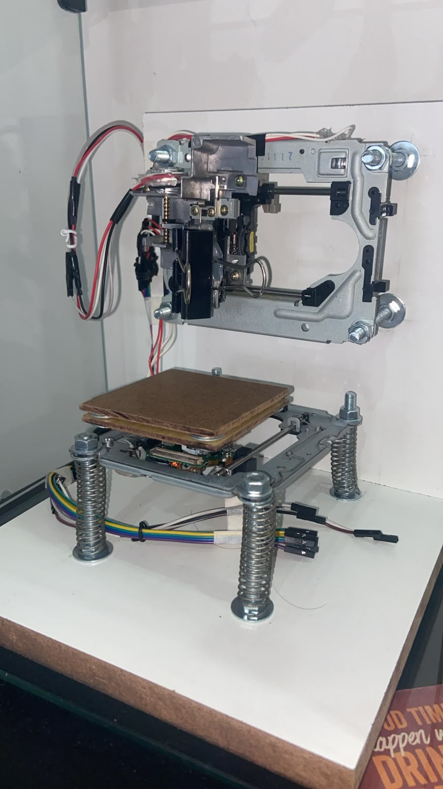

# Construção, materiais e conexões elétricas

## Componentes utilizados

| Item | Quantidade e especificação registrada |
| :-- | :-- |
| Conjuntos lineares | 2 mecanismos de DVD e 1 de disquete, com seus motores |
| Estrutura | 2 bases de madeira, 20 × 20 × 1,5 cm |
| Cama de impressão | Base de madeira de 7 × 7 × 0,3 cm |
| Fixação | 8 parafusos de 6 mm × 8 cm, 16 arruelas grandes e 16 pequenas |
| Suporte de escrita | Caneta BIC multicolor, prendedor para caneta e 4 grampos para papel |
| Controladora | Arduino Uno e cabo USB/serial |
| Expansão | CNC Shield V3 diretamente encaixada nos conectores do Arduino Uno |
| Drivers | 3 × A4988 com dissipadores instalados na CNC Shield V3 |
| Alimentação | Fonte externa de 12 V / 5 A com borne |
| Acessórios | Jumpers e cabos de ligação |

**Ferramentas utilizadas:** parafusadeira, brocas, lixa 150, cola quente, cola instantânea, esmerilhadeira, corte e esquadrejamento de madeira, multímetro, fita isolante e fita crepe.

## Interligação funcional

A **CNC Shield V3 é montada diretamente sobre os pinos do Arduino Uno**, sem cabeamento de sinais entre as duas placas. Cada driver **A4988** é instalado no respectivo soquete da Shield. Os motores X, Y e Z são conectados à etapa de acionamento por meio dos bornes/conectores disponibilizados pela Shield. O **Arduino recebe a conexão USB** do notebook, que permite a comunicação serial e alimenta a lógica, enquanto a **fonte 12 V / 5 A** fornece alimentação externa para os motores através da Shield.

Este diagrama é **funcional**, não um esquema elétrico de pinagem ou de polaridade. Posição dos drivers, orientação, compatibilidade dos conectores e requisitos elétricos devem ser conferidos com a versão física da placa antes de energizar. Não desconectar motores com drivers energizados.

## Registros de medição

| Parâmetro | Valor registrado no protótipo |
| :-- | :-- |
| Resistência aproximada X / Y | 10,5 a 11 Ω |
| Resistência aproximada Z | 20 Ω |
| Resistor sensor informado do driver | 0,1 Ω |
| Tensão de referência anotada | 350 mV |

**Esses valores descrevem uma montagem específica e não são instruções de configuração genéricas do driver A4988.** Antes de fazer qualquer ajuste, é necessário conferir as especificações elétricas do conjunto usado.

## Fotografias

