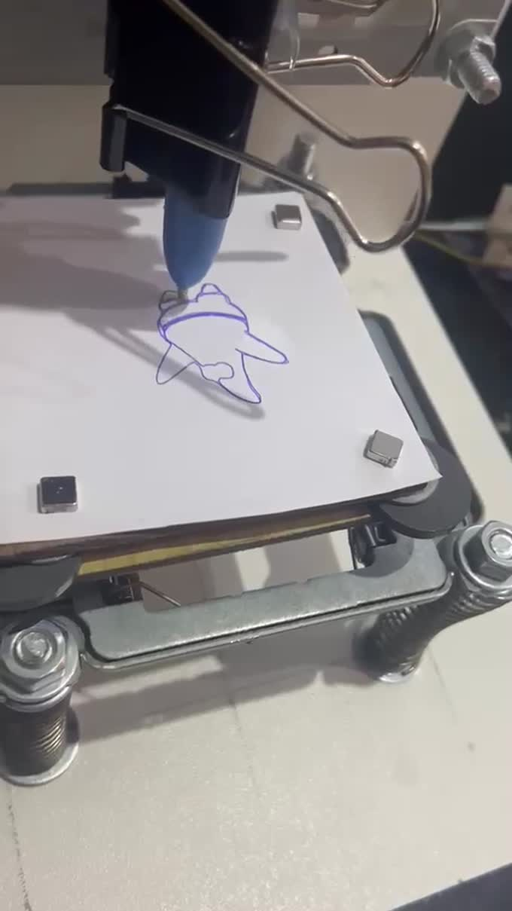
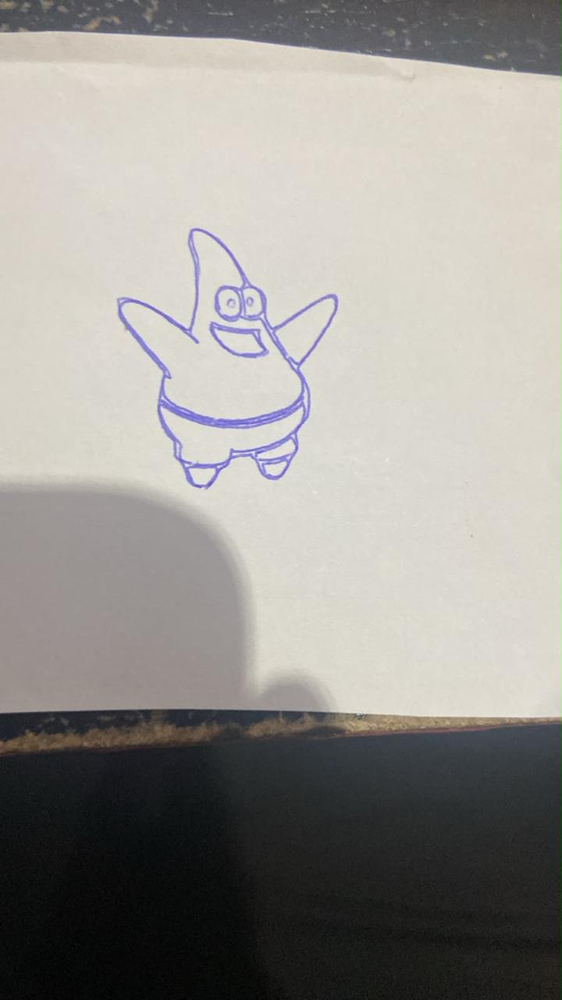

# Resultados e registros de demonstração

## Evidências físicas disponíveis

| Registro | Duração | Evidência |
| --- | ---: | --- |
| [Motor antes da montagem](videos/01_teste_motor_antes_montagem.mp4) | 20,1 s | Teste preliminar de acionamento de mecanismo |
| [Execução inicial sem função no Z](videos/02_execucao_inicial_sem_z.mp4) | 35,5 s | Evolução da estrutura com caneta e cama de impressão |
| [Calibração de limites sem caneta](videos/03_calibracao_limites_sem_caneta.mp4) | 15,6 s | Ensaio de movimentação sem traçado |
| [Patrick](videos/04_execucao_patrick.mp4) | 81,2 s | Máquina desenhando em papel |
| [Luffy](videos/05_execucao_luffy.mp4) | 12,6 s | Demonstração de desenho na máquina |

## Avaliação qualitativa

Os registros permitem conferir **a existência de movimentos, uma cadeia funcional de preparação/traçado e resultados físicos em papel**. Não foram fornecidos ensaios formais de repetibilidade, erro posicional, fidelidade por escala ou velocidade; não há base para publicar percentuais de acurácia ou garantia de resolução física.

Os vídeos foram preservados sem recodificação; os pôsteres são quadros extraídos desses registros. A revisão desta publicação verificou metadados e amostras de quadros, sem registrar um novo ensaio físico. A fotografia de resultados de pessoas reais e as imagens de origem correspondentes não foram incluídas no repositório público de preparação por precaução de privacidade e direitos de imagem.

Para relacionar os registros à evolução do software, consulte [validação e limites das evidências](validacao.md).
