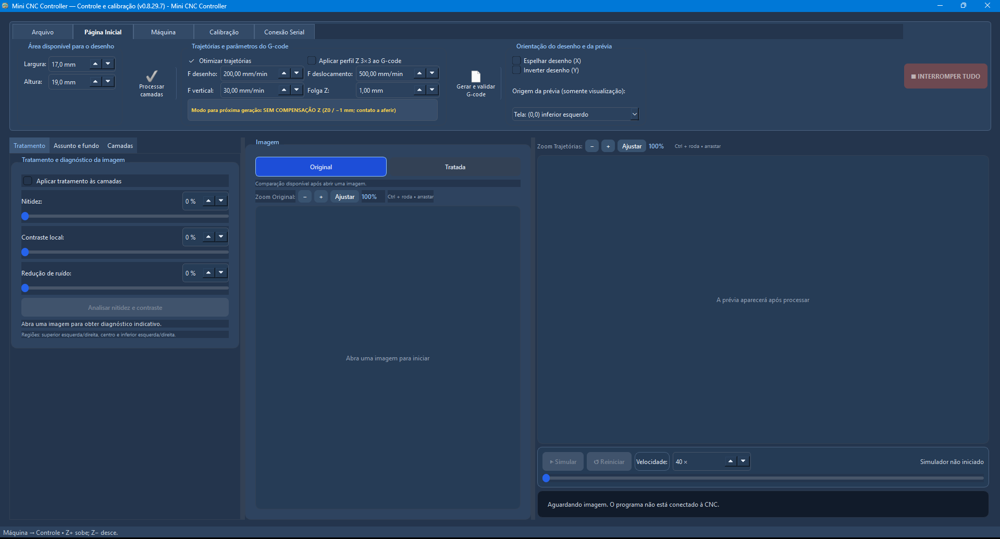
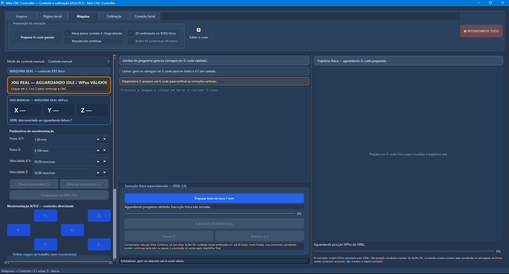
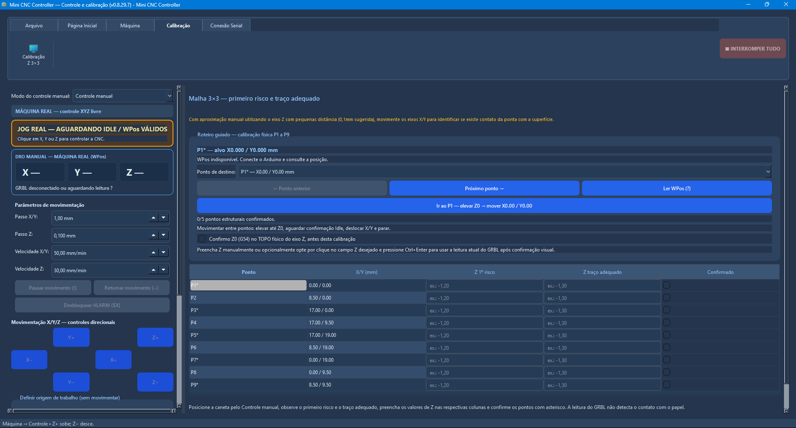
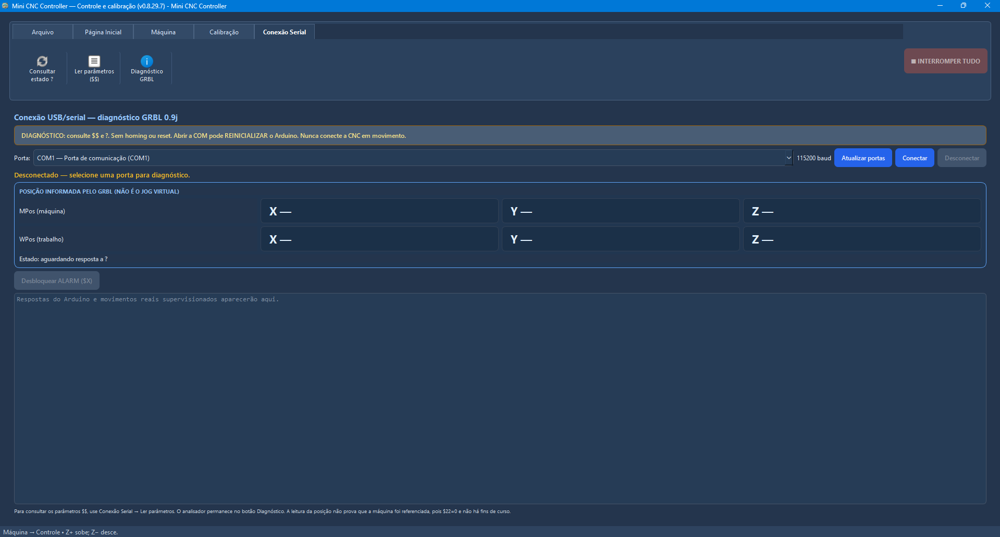

# Mini CNC Controller — software v0.8.29.7

O Mini CNC Controller é um aplicativo Windows desenvolvido em **Python/PySide6** para conectar tratamento de imagem e operação de um mini plotter XYZ. O desenvolvedor confirmou a operação da versão de referência no equipamento real; isso não certifica todas as funcionalidades ou versões posteriores.

## Funções de imagem

- Importar fotografias ou imagens, visualizar e ajustar enquadramento e orientação 2D.
- Ajustar contraste, detalhes, sombras, máscaras e camadas de processamento.
- Empregar assistência de visão computacional para isolamento ou remoção de fundo, com validação manual de regiões.
- Gerar e exportar uma prévia PNG do resultado a ser desenhado.

## Trajetórias e G-code

- Planejar, otimizar, gerar e editar trajetórias 2D e G-code.
- Importar e exportar arquivos G-code.
- Visualizar as alterações, executar simulação e conferir o percurso antes da comunicação com a CNC.
- Acompanhar a execução física e suas etapas.

## Integração e calibração

- Conectar via USB/serial ao Arduino Uno com GRBL 0.9j.
- Operar controle manual dos eixos e monitorar o estado do equipamento.
- Criar, importar e salvar perfis de calibração, incluindo malha de compensação Z 3×3 quando aplicável.
- Confirmar as condições de deslocamento antes de iniciar o desenho físico.

## Tratamento assistido por IA

O histórico do projeto registra uma prova de conceito com **LR-ASPP, DeepLabV3 e IS-Net** para segmentação/remoção de fundo e aplicação de máscaras. A qualidade e a densidade finais do desenho dependem da revisão da imagem, da calibração e das limitações físicas da máquina.

## Capturas de tela

**Disponibilização:** o código-fonte autoral, o executável, os scripts de desenvolvimento, os modelos e os pesos de IA não acompanham este portfólio. A documentação é demonstrativa e técnica, sem fornecer o aplicativo para download.

## Complementos da publicação

Consulte [visão computacional e IA](visao_computacional.md) para distinguir processamento clássico, integração de modelos e contribuição autoral. Consulte [validação](validacao.md) para o alcance das evidências. As capturas desta página e o relatório PDF permanecem na referência histórica v0.8.29.7.
